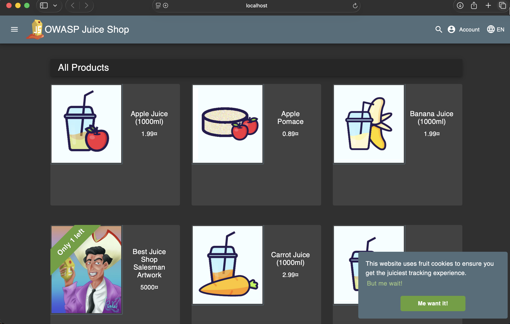
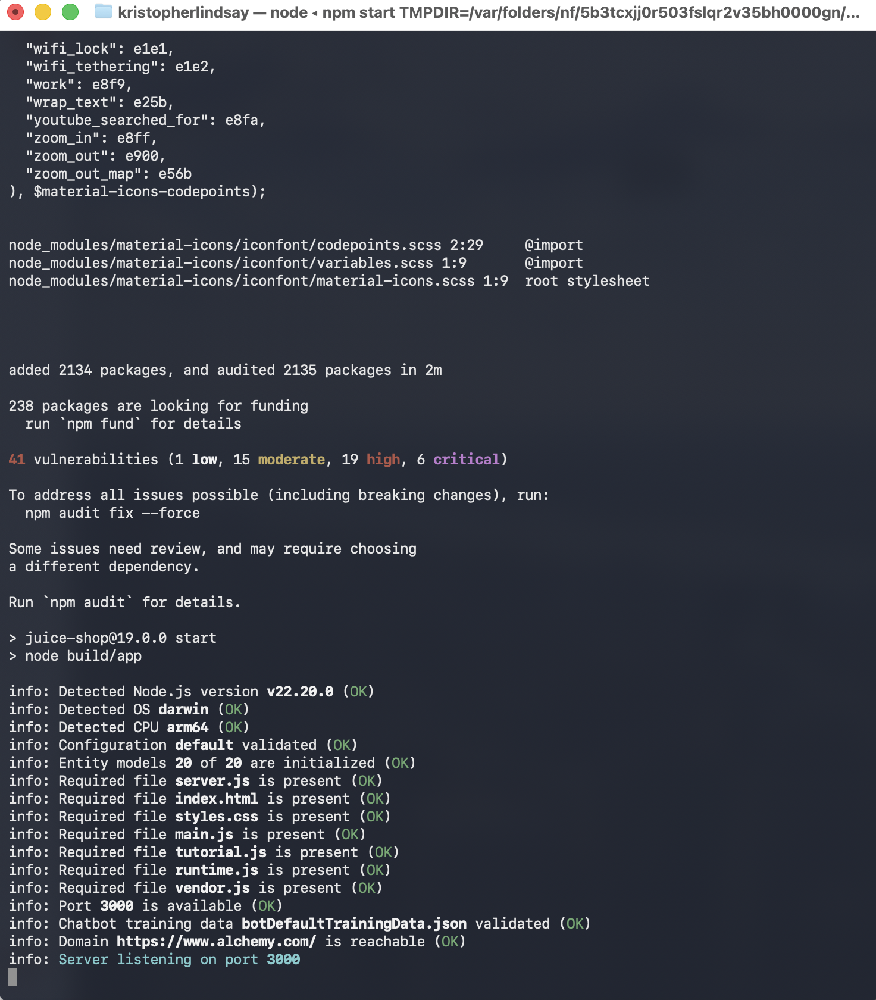
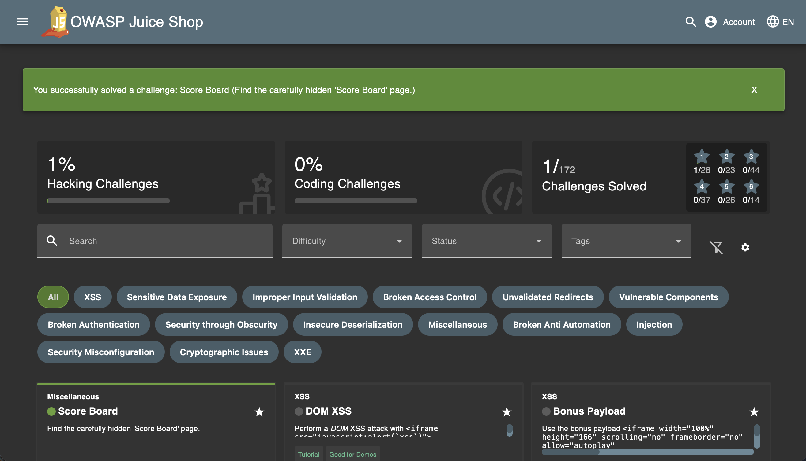
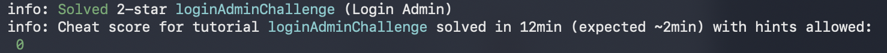
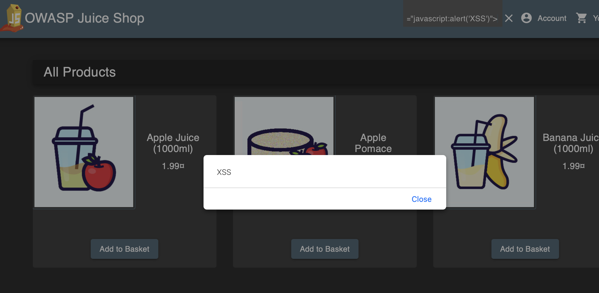
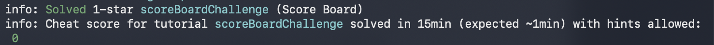
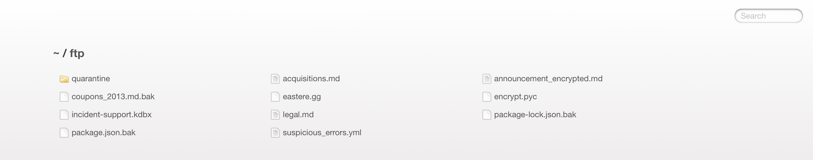

# OWASP Web Application Security Lab

## Lab Overview

Practice against OWASP Juice Shop, an application that is intentionally vulnerable. The startup screenshot prints `juice-shop@19.0.0` on localhost port 3000. This folder has screenshots and this write-up. It does not contain the Juice Shop source, and it is not an assessment of a production site.

The Score Board screenshot shows **1/172** challenges solved at the time it was taken. 172 is the catalog size in that view. Separate screenshots show the Login Admin challenge marked solved, a browser alert reading `XSS`, and the `/ftp` directory listing. The SQL and XSS payloads written below are the write-up's account of the attempts. They are not visible as request text in the screenshots.

## Tools Used
- **OWASP Juice Shop** - Intentionally vulnerable web application for security training
- **Node.js** - JavaScript runtime environment
- **Web Browser** - For testing and exploitation
- **Command Line** - Application deployment and management

## Learning Objectives
- Understand OWASP Top 10 vulnerabilities
- Practice web application penetration testing
- Identify common security misconfigurations
- Demonstrate ethical hacking techniques

## Methodology

### 1. Environment Setup
- Installed Node.js on macOS
- Cloned OWASP Juice Shop from GitHub repository
- Deployed application locally on port 3000
- Accessed web interface at http://localhost:3000

### 2. Reconnaissance and Discovery
- Explored application functionality and features
- Identified hidden administrative interfaces
- Located Score Board to track security challenges
- Mapped application structure and endpoints

### 3. Vulnerability Exploitation

#### A. SQL Injection (Authentication Bypass)
**Vulnerability Type:** A03:2021 - Injection

**Attack Vector:**
- The write-up records a login-form payload of `' OR 1=1--` in the email field
- `5-sql-injection-success-banner.png` shows the Juice Shop banner "Login Admin (Log in with the administrator's user account.)"
- `04-sql-injection-terminal.png` shows one solved challenge, `loginAdminChallenge`
- Neither image shows the request payload

**Impact:** Complete authentication bypass allowing unauthorized access to user accounts

**Mitigation:** Implement parameterized queries, input validation, and prepared statements

#### B. Cross-Site Scripting (XSS)
**Vulnerability Type:** A03:2021 - Injection

**Attack Vector:**
- The write-up records the payload `<iframe src="javascript:alert('XSS')">` in the search function
- `03-xss-alert-popup.png` shows a dialog whose text is `XSS`, with `javascript:alert('XSS')` visible in the browser chrome
- The iframe string itself is not shown in that screenshot

**Impact:** Potential for session hijacking, credential theft, and malicious actions on behalf of users

**Mitigation:** Implement input sanitization, output encoding, Content Security Policy (CSP)

#### C. Sensitive Data Exposure
**Vulnerability Type:** A01:2021 - Broken Access Control

**Attack Vector:**
- Discovered unprotected FTP directory at `/ftp` endpoint
- Accessed without authentication or authorization
- The screenshot lists file names, including `incident-support.kdbx` and several `.bak` files. It does not open them

**Files Discovered:**
- `incident-support.kdbx` - listed in the `/ftp` screenshot. The name is a KeePass-style database. The screenshot does not open the file
- `package.json.bak` - Dependency information revealing potential vulnerabilities
- `legal.md` - Confidential legal documents
- `acquisitions.md` - Business sensitive information
- Configuration and backup files

**Impact:** The listing shows those names on a training app. It does not show the contents of the kdbx file or the markdown files.

**Mitigation:** Implement proper access controls, remove backup files from web-accessible directories, use .htaccess or server configuration to restrict directory access

## Key Findings

### Security Vulnerabilities Identified
What the screenshots support:
- Login Admin is marked solved (banner and one terminal line). The SQL payload is text in this write-up, not in the images.
- A browser alert whose text is `XSS` on the Juice Shop page. The screenshots do not include a "challenge solved" line for XSS.
- `/ftp` is reachable in the screenshot and lists `incident-support.kdbx` among other names. The file is not opened.

### Attack Surface Analysis
- Login forms vulnerable to SQL injection
- Search functionality lacks input validation
- Directory traversal and direct object reference weaknesses
- Insufficient access controls on sensitive directories

### Risk Assessment
Ratings below are the write-up's ratings for this training app. The kdbx file is listed, not opened.

**Critical:** Password-database filename in the listing, and the Login Admin challenge marked solved
**High:** XSS vulnerabilities enabling session hijacking
**Medium:** Information disclosure through exposed configuration files

## Skills Demonstrated

Practice on local Juice Shop only. The screenshots do not show a test of a production application.

- Web application penetration testing
- OWASP Top 10 vulnerability exploitation
- SQL injection techniques
- Cross-Site Scripting (XSS) attacks
- Access control testing
- Security misconfiguration identification
- Risk assessment and impact analysis
- Security documentation and reporting

## Real-World Applications

Study notes from a deliberately vulnerable app. Not an engagement and not client work.

- **Security Testing:** Methodologies applicable to web application security assessments
- **Vulnerability Research:** Understanding common attack patterns and exploitation techniques
- **Secure Development:** Knowledge of vulnerabilities informs secure coding practices
- **Risk Management:** Ability to assess and communicate security risks to stakeholders

## Technical Environment
- **Application:** OWASP Juice Shop 19.0.0, as printed in `07-application-startup-terminal.png` (`juice-shop@19.0.0`). Not "latest" as of this documentation pass
- **Platform:** macOS, darwin arm64, as printed in that startup log
- **Runtime:** Node.js v22.20.0, as printed in that startup log
- **Browser:** Modern web browser with developer tools
- **Deployment:** Local development server (localhost:3000)

## Mitigation Recommendations

### General Security Controls
- Implement input validation and sanitization
- Use parameterized queries for database operations
- Apply principle of least privilege for file access
- Remove or secure backup and configuration files
- Implement Content Security Policy (CSP)
- Regular security testing and code reviews
- Web Application Firewall (WAF) deployment

### Specific Fixes
1. **SQL Injection Prevention:**
   - Use prepared statements with parameterized queries
   - Implement stored procedures
   - Apply input validation with whitelisting

2. **XSS Prevention:**
   - Encode all user-supplied data before rendering
   - Implement Content Security Policy
   - Use modern frameworks with built-in XSS protection

3. **Access Control:**
   - Implement authentication and authorization checks
   - Restrict directory listings
   - Remove sensitive files from web-accessible locations
   - Use role-based access control (RBAC)

## Screenshots

### Lab Setup

*OWASP Juice Shop application homepage*

*Juice Shop successfully deployed on localhost:3000*

### Vulnerability Exploitation

*Score Board at the time of the screenshot: 1 of 172 hacking challenges solved (the Score Board challenge). 172 is the catalog size, not the number completed.*

*Juice Shop banner for the Login Admin challenge. The banner does not show the request payload.*

*Terminal line for one solved challenge: loginAdminChallenge (Login Admin).*

*Browser alert whose text is XSS. javascript:alert('XSS') is visible in the browser chrome. The iframe payload in the write-up is not shown in this image.*

*Terminal lines for one solved challenge: scoreBoardChallenge (Score Board). Not a list of several challenges.*

*Juice Shop /ftp listing. Visible names include incident-support.kdbx, package.json.bak, legal.md, and acquisitions.md. The kdbx file is not opened in the screenshot.*
---
*Lab completed as part of web application security skills development*
