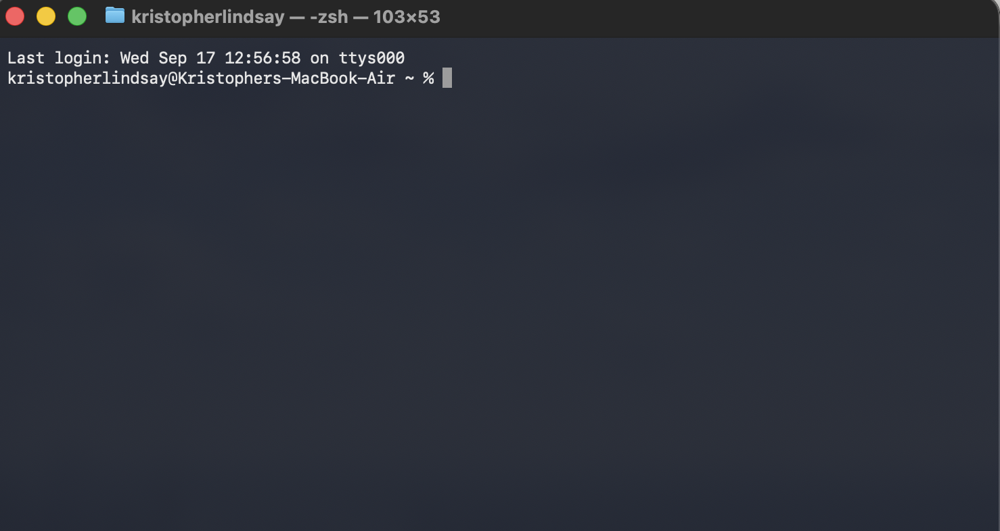
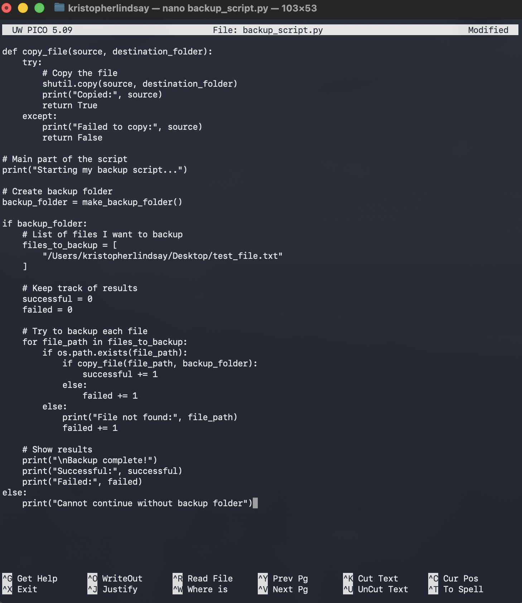
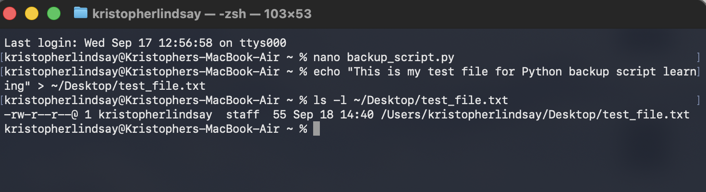
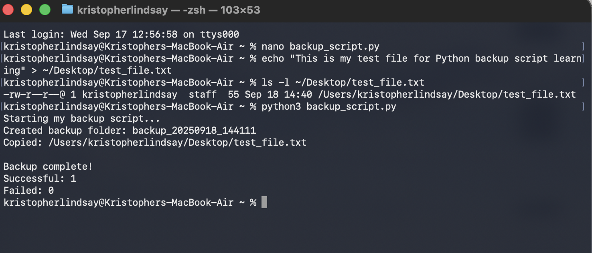
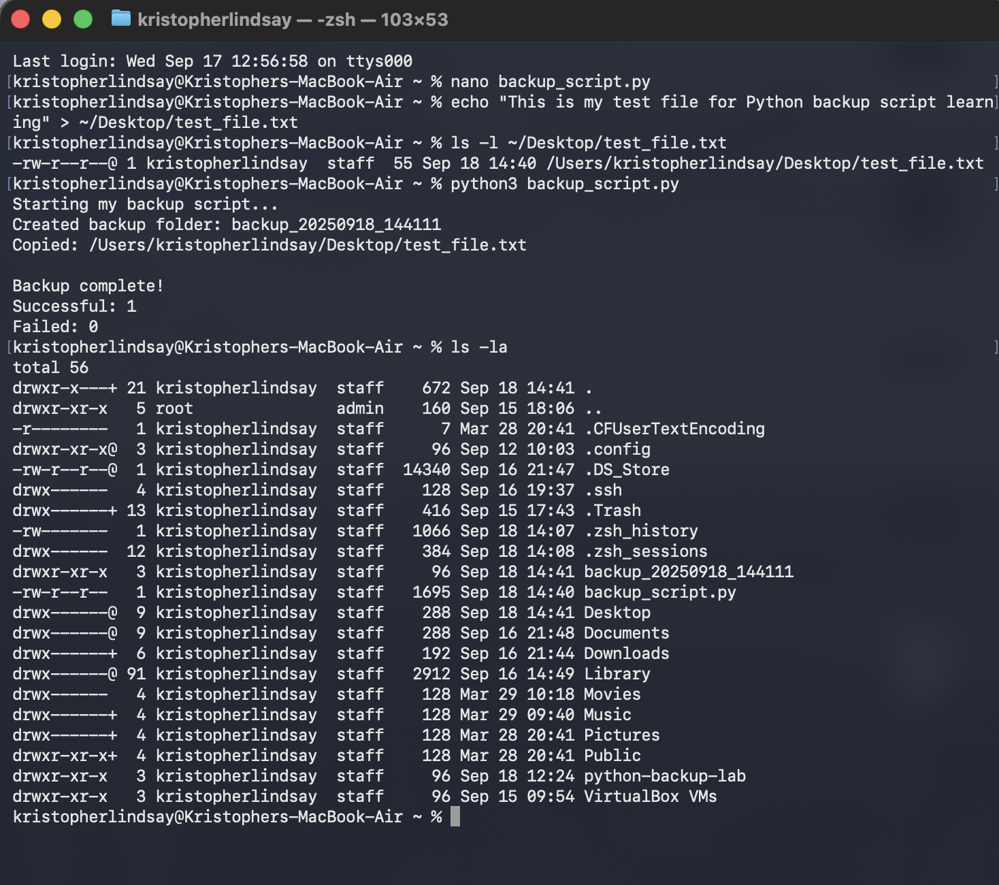
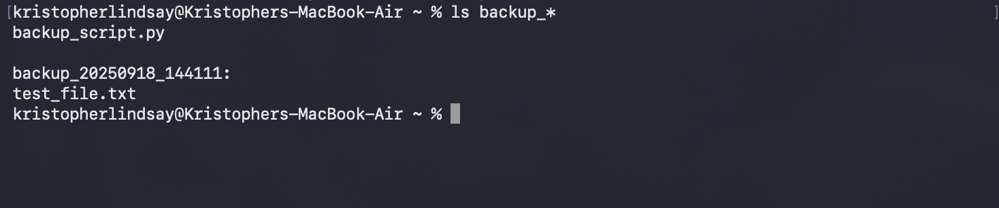

# Python Backup Automation Script

## Lab Overview
Created my first Python automation script to backup files, demonstrating programming fundamentals and practical automation skills for cybersecurity applications.

## Learning Objectives
- Learn Python programming basics
- Understand file system operations
- Practice error handling concepts
- Build practical automation tools

## Tools Used
- **Python 3** - Programming language
- **macOS Terminal** - Development environment
- **Nano** - Text editor for script development
- **Built-in Python libraries**: os, shutil, datetime

## Methodology

### 1. Script Development Process
- Started with basic Python script structure
- Added simple functions for folder creation and file copying
- Implemented basic error handling with try/except blocks
- Used clear variable names and comments for learning

### 2. Key Programming Concepts Applied
- **Functions**: Created `make_backup_folder()` and `copy_file()` functions
- **Variables**: Used descriptive names like `backup_folder` and `files_to_backup`
- **Loops**: Implemented for loop to process multiple files
- **Conditionals**: Used if/else statements for error checking
- **Exception Handling**: Added try/except blocks for robust operation

### 3. File Operations Implementation
- Used `os.mkdir()` to create directories
- Applied `shutil.copy()` for file copying operations
- Implemented `os.path.exists()` to check file availability
- Used `datetime.now()` for timestamp generation

### 4. Testing and Validation
- Created test file for backup demonstration
- Ran script multiple times to verify functionality
- Checked backup folder contents to confirm file copying
- Verified error handling with non-existent files

## Script Functionality

### Core Features
- **Timestamped Backup Folders**: Creates folders with date/time stamps
- **File Validation**: Checks if files exist before attempting backup
- **Error Reporting**: Shows clear success/failure messages
- **Result Summary**: Displays count of successful and failed operations

### The script

[`backup_script.py`](backup_script.py) is a **reconstruction**. I wrote the original in September 2025 and the screenshots below show it running, but I lost the file when I changed macOS accounts. I rebuilt it from those screenshots and from the function I had written up in this README. Two small differences from the original: the imports at the top were not visible in the screenshots, so I added the three the code needs, and the test file path uses `os.path.expanduser("~/Desktop/test_file.txt")` instead of my old hardcoded home folder.

Sample code (excerpt):

```python
# Simple function to create backup folder
def make_backup_folder():
    now = datetime.now()
    folder_name = "backup_" + now.strftime("%Y%m%d_%H%M%S")
    try:
        os.mkdir(folder_name)
        print("Created backup folder:", folder_name)
        return folder_name
    except:
        print("Could not create folder")
        return None
```

### How to run

```bash
echo "test" > ~/Desktop/test_file.txt
cd python-backup-lab
python3 backup_script.py
```

Run it from inside `python-backup-lab`, because the backup folder is created in whatever directory you run it from.

**Verified 2026-11-07** on my current Mac account: one file copied, `Successful: 1`, `Failed: 0`, new folder `backup_20261107_130540` containing only `test_file.txt`.

It creates a folder like `backup_20250918_144111` in the directory you run it from, copies `test_file.txt` into it, and prints how many files succeeded and failed. If the test file doesn't exist, it prints "File not found" and counts it as a failure.

### Known limitations

- It backs up one hardcoded file. The list in `files_to_backup` has to be edited by hand.
- It uses bare `except:` blocks, so it reports that a copy failed but not why.
- It makes a new folder on every run and never deletes old ones.

## Screenshots


*Starting directory*


*Writing the script*


*Creating a test file to back up*


*Running the script*


*Checking the results*


*Validating the backup folder contents*
