# Splunk SIEM Lab - Security Monitoring and Threat Detection

## Overview

This lab uses Splunk Cloud on a sample Apache log that contains simulated attack rows. The source name visible in the search screenshots is `sample-apache-logs.txt.rtf`. The log file itself is not in this repository. Findings below are about that sample. They are not a live incident, and the recommendations are exercise conclusions, not changes made on a production system.

Screenshots checked against the prose on 2026-11-07: `07-data-loaded-search-results.png` (38 events), `08-failed-logins-401.png` (10 events with `status=401`), `09-brute-force-by-ip.png` (`10.0.0.50` and `203.0.113.45`, 5 events each in that view), `10-attack-timeline-internal.png` (13 rows for `10.0.0.50`), `11-external-attacker-activity.png` (6 rows for `203.0.113.45`), `11-sensitive-data-access.png`, `12-brute-force-detection-rule.png`, and `18-data-exfiltration-detection.png`. `203.0.113.45` is inside the [RFC 5737](https://www.rfc-editor.org/info/rfc5737) documentation range `203.0.113.0/24`.

## Tools and Technologies
- **Splunk Cloud Platform** - Cloud trial, as shown by the `splunkcloud.com` host in the search screenshots
- **Apache Web Server Logs** - Sample file named `sample-apache-logs.txt.rtf` in the screenshots. Not committed here
- **Search Processing Language (SPL)** - Query language used in the searches below

## What I Did

### Setting Up the Environment
I signed up for a Splunk Cloud free trial and accessed my personal SIEM instance. After getting familiar with the interface, I prepared sample Apache web server logs that included both normal traffic and malicious activity patterns.

### Data Ingestion
I uploaded the log file to Splunk and configured it as Apache access logs (access_combined sourcetype). Splunk automatically parsed the logs and extracted important fields like client IP addresses, HTTP status codes, requested URIs, and timestamps. In total, 38 events were indexed and ready for analysis.

### Investigation Process

#### Finding Failed Login Attempts
My first search was simple - looking for HTTP 401 status codes which indicate authentication failures:
```
index="main" sourcetype="access_combined" status=401
```

This returned 10 failed login attempts from two different IP addresses, which immediately raised suspicion of potential brute force attacks.

#### Identifying the Attackers
I created a query to count failed attempts by IP and filter for anything above 3 failures:
```
index="main" sourcetype="access_combined" status=401 
| stats count as failed_attempts by clientip 
| where failed_attempts >= 3
| sort -failed_attempts
```

This identified two sources:
- **10.0.0.50** - Internal IP with 5 failed attempts, then successful login
- **203.0.113.45** - External IP with 5 failed attempts, all blocked

The internal IP was particularly concerning since it eventually succeeded in authenticating.

#### Analyzing the Internal Threat
I investigated what happened after the internal attacker gained access:
```
index="main" sourcetype="access_combined" clientip="10.0.0.50" 
| table _time clientip status uri_path
```

`10-attack-timeline-internal.png` lists 13 events for this IP. In time order they are:

1. Five `401` responses for `/admin/login` at 13:23:11, 13:23:14, 13:23:17, 13:23:20, and 13:23:23
2. `200` for `/admin/login` at 13:23:26
3. `200` for `/admin/dashboard` at 14:55:10 and `/admin/users` at 14:56:45
4. `200` for `/admin/config/database.xml` at 14:58:33 and `/admin/config/passwords.txt` at 15:02:18
5. `404` for `/../../etc/passwd` at 15:25:55
6. `200` for `/admin/logs/access.log` at 15:26:12
7. `200` for `/admin/download` at 17:15:33 (`18-data-exfiltration-detection.png` shows this row and does not show a byte count)

An earlier version of this list said authentication succeeded at 3:02 PM. The screenshot places the `200` login at 13:23:26. The 15:02:18 row is `passwords.txt`, not the login. The 2.4MB figure is not printed on the screenshots named in the overview. The sample shows those URLs and status codes. It does not show that a credential file was opened, that logs were wiped, or that anyone responded on a live network.

#### Checking the External Attacker
I ran the same analysis on the external IP:
```
index="main" sourcetype="access_combined" clientip="203.0.113.45"
```

`11-external-attacker-activity.png` shows 6 rows for this address, all to `/admin/login`: a `200` at 18:22:10, then `401` at 18:22:33, 18:22:36, 18:22:39, 18:22:45, and 18:22:48. The table does not include the HTTP method. An earlier version of this section said every authentication attempt failed and that the `200` was a GET of the login page. That method split is not in the screenshot. `08-failed-logins-401.png` does show `POST /admin/login` with status 401 for this address among the 10 failed-login events.

#### Detecting Sensitive File Access
I created a detection query to find any access to critical files:
```
index="main" sourcetype="access_combined" status=200 
(uri_path="*/passwords*" OR uri_path="*/database*" OR uri_path="*/config*")
| table _time clientip uri_path
```

The screenshot `11-sensitive-data-access.png` shows two `200` rows: `/admin/config/passwords.txt` at 15:02:18 and `/admin/config/database.xml` at 14:58:33, both from `10.0.0.50`. The image does not show the file bodies.

#### Finding Data Exfiltration
To detect large downloads, I searched for successful access to download endpoints:
```
index="main" sourcetype="access_combined" uri_path="*/download*" status=200
| table _time clientip uri_path
```

`18-data-exfiltration-detection.png` shows one `200` row for `/admin/download` from `10.0.0.50` at 17:15:33. It does not show a response size. The 2.4MB figure is not in that screenshot.

### Building a Security Dashboard
I created a monitoring dashboard with three visualizations:

**Panel 1: Failed Login Attempts Over Time**
```
index="main" sourcetype="access_combined" status=401 
| timechart count by clientip
```
This counts `401` events by client IP across the sample. The screenshots use an "All time" range on a static file, not a live stream.

**Panel 2: Login Success vs Failure Rate**
```
index="main" sourcetype="access_combined" 
| eval login_status=if(status=200,"Success","Failed")
| stats count by login_status
```
A pie chart of the query above. The `eval` labels every HTTP 200 as `Success` and every other status as `Failed`, so the chart is not limited to login requests.

**Panel 3: Most Accessed Resources**
```
index="main" sourcetype="access_combined" 
| stats count by uri_path 
| sort -count 
| head 10
```
Bar chart showing which pages/files are being accessed most frequently.

### Creating Detection Rules
The write-up describes three searches that could be saved as alerts. `12-brute-force-detection-rule.png` shows the first query as a New Search, not an enabled alert. This folder does not show alert actions turned on.

1. **Brute Force Detection** - `status=401`, then `stats count by clientip` where count is at least 3. The screenshot shows count 5 for both `10.0.0.50` and `203.0.113.45`.
2. **Sensitive File Access** - `200` responses whose path matches passwords, database, or config, as in the query above
3. **Data Exfiltration** - the query matches `/download*` with status 200. It does not filter on bytes, so it does not by itself detect a large download

## Key Findings

In the sample, internal IP `10.0.0.50`:
- Five `401` responses on `/admin/login`, then a `200` on that path
- `200` responses for `/admin/config/database.xml` and `/admin/config/passwords.txt`
- A path-style URL `/../../etc/passwd` returned `404`
- A `200` on `/admin/download`, with no byte count in the screenshots reviewed on 2026-11-07
- The exercise rating recorded with this lab was **CRITICAL**. That rating was not a ticket on a live system

In the sample, `203.0.113.45` ([RFC 5737](https://www.rfc-editor.org/info/rfc5737) documentation range):
- `11-external-attacker-activity.png` shows 6 rows, all `/admin/login`: one `200` at 18:22:10 and five `401`s. That table does not show the HTTP method
- `08-failed-logins-401.png` shows `POST /admin/login` with status 401 for this address
- The exercise rating recorded with this lab was **LOW**

## What I Learned

This lab gave me practical experience with SIEM operations and log analysis. I learned how to use SPL to search through logs, identify attack patterns, and build detection rules. The sample rows show a progression of URLs after the `200` on `/admin/login`. That is the sample, not a live intrusion.

I also learned the importance of monitoring failed login attempts, implementing account lockout policies, and restricting access to sensitive files. The dashboard screenshots are from this 38-event sample. They are not a deployment in a SOC.

## Security Recommendations

Hypothetical follow-ups for this sample. None of these actions were performed on a live system as part of the lab. `10.0.0.50` is a client IP in the log, not an account name. On the `401` rows in `08-failed-logins-401.png`, the ident field is `admin`.

**Immediate Actions:**
- Treat client IP 10.0.0.50 as the source to investigate in the sample
- Force password reset for admin accounts in a system that actually had this log
- Block 203.0.113.45 at a firewall only if it were a real source; it is a documentation-range address
- Review the URLs that returned `200` for 10.0.0.50
- Look for further download URLs in the same sample

**Short-Term Fixes:**
- Implement account lockout after 3 failed attempts
- Enable multi-factor authentication for admin accounts
- Move sensitive files out of web accessible directories
- The write-up describes three saved searches that could become alerts. The screenshots show the queries. This folder does not show that alerts were turned on

**Long-Term Improvements:**
- Deploy a Web Application Firewall
- Implement data-loss-prevention controls
- Increase logging detail for administrative actions
- Regular security awareness training

## Environment Details
- SIEM: Splunk Cloud Platform (free trial)
- Data Source: Apache Combined Access Logs
- Query Language: Search Processing Language (SPL)
- Dataset: 38 events containing normal and malicious activity

## Screenshots

### Setup and Data Ingestion
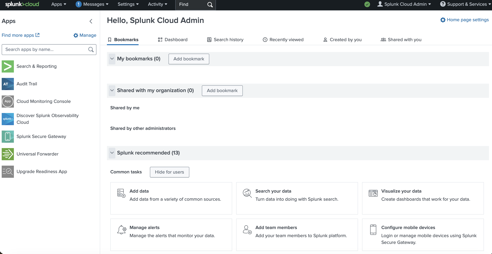
*Splunk Cloud interface after initial login*

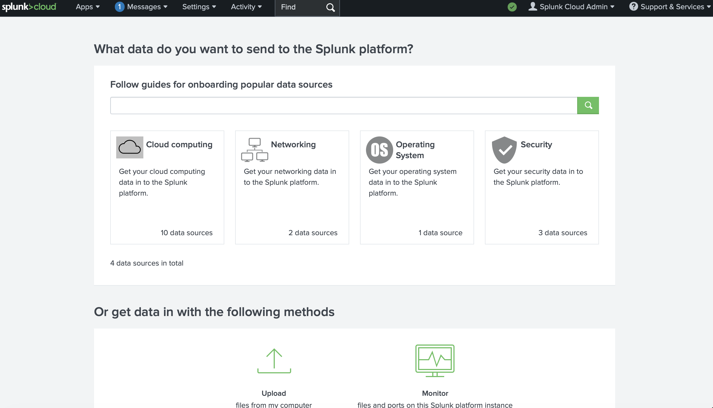
*Data ingestion interface*

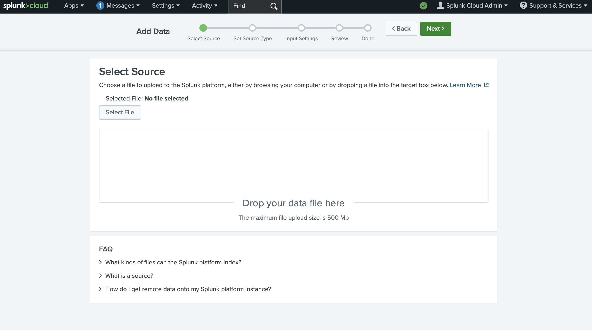
*Uploading Apache logs*

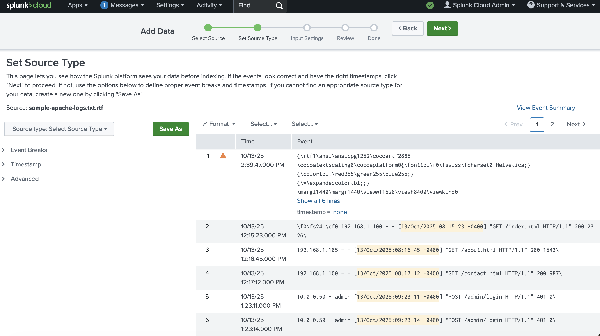
*Splunk parsing the log format*

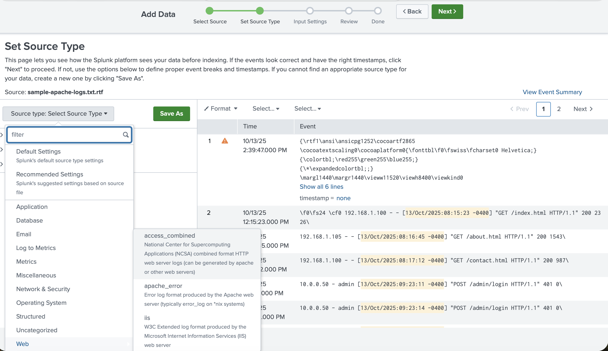
*Configuring the data source*

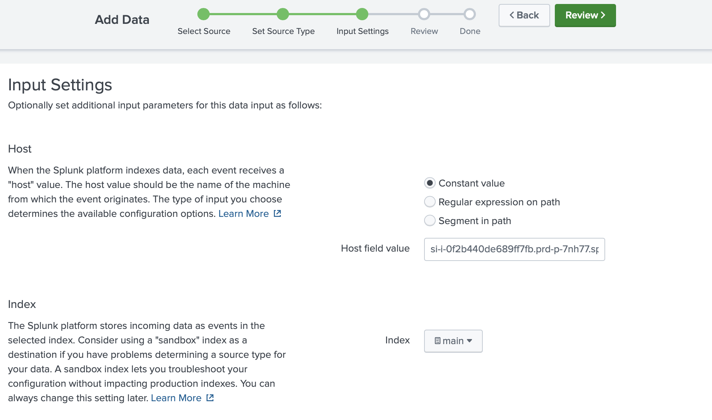
*Final review before ingestion*

### Investigation and Analysis
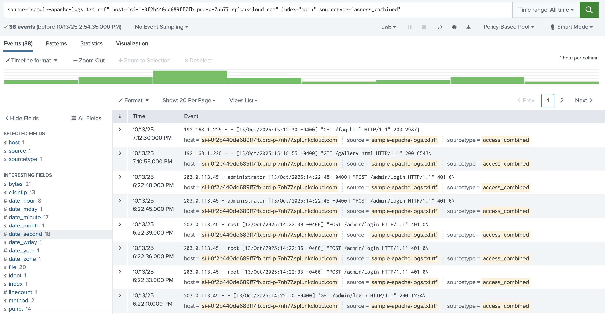
*Successfully loaded 38 events*

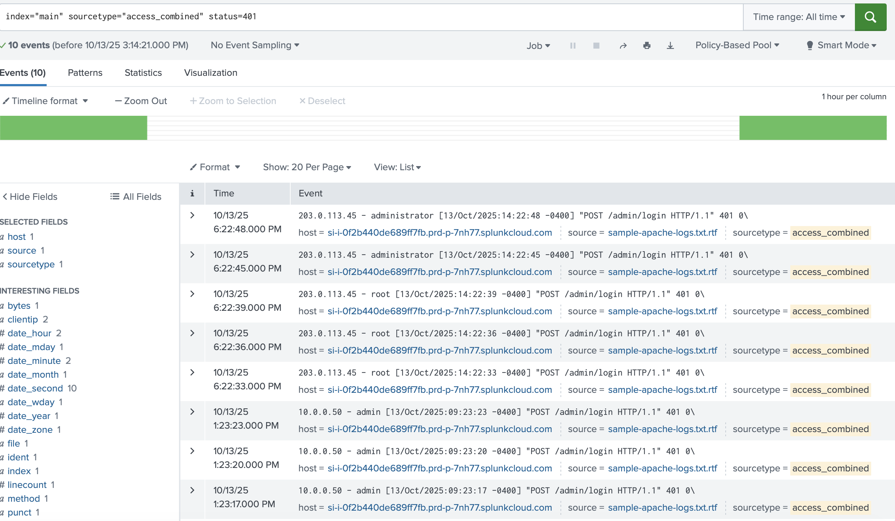
*Detected 10 failed authentication attempts*

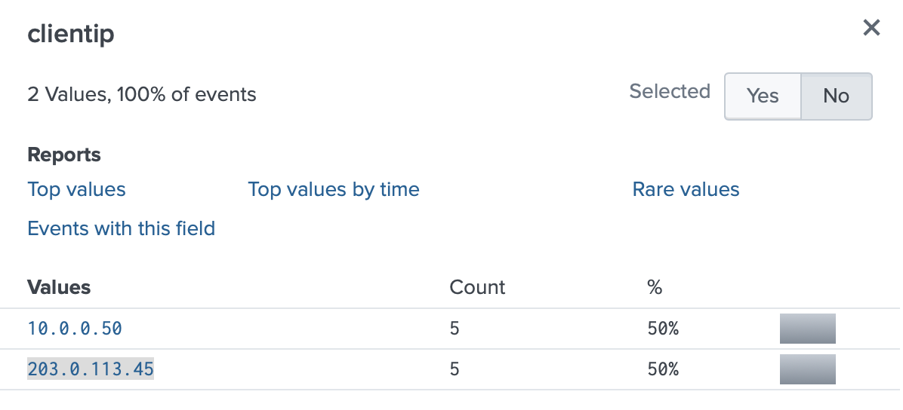
*Two IPs with multiple failed logins*

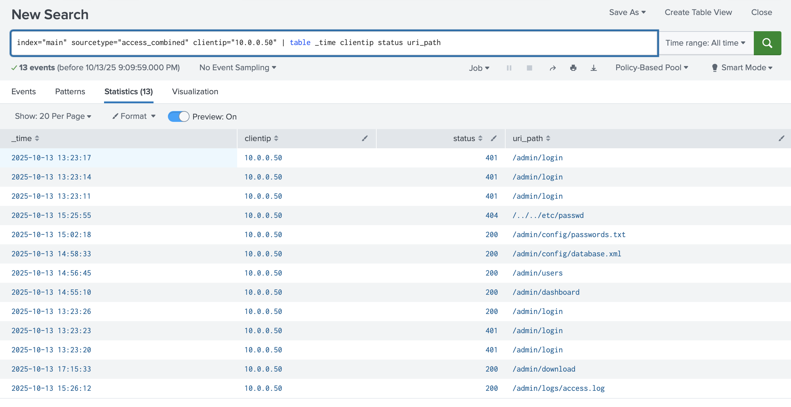
*Timeline of internal attacker activity*

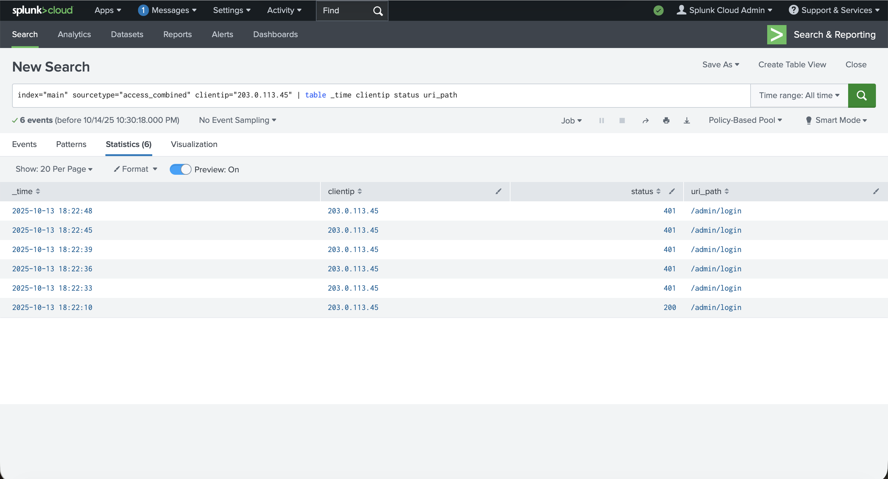
*Six rows for 203.0.113.45, all /admin/login: one 200 at 18:22:10 and five 401s. The HTTP method is not in the table.*

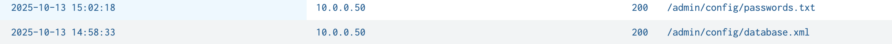
*Two 200 rows for 10.0.0.50: passwords.txt at 15:02:18 and database.xml at 14:58:33. File contents are not shown.*

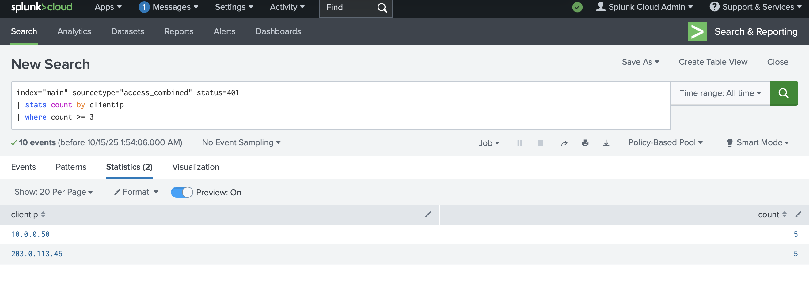
*status=401, stats count by clientip where count >= 3. Both sample IPs have count 5. The screen is a New Search, not an enabled alert.*

### Dashboard and Detection
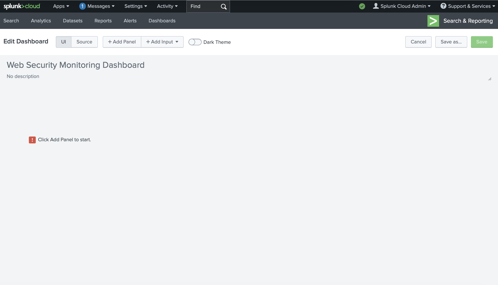
*Empty editor for a dashboard titled Web Security Monitoring Dashboard.*

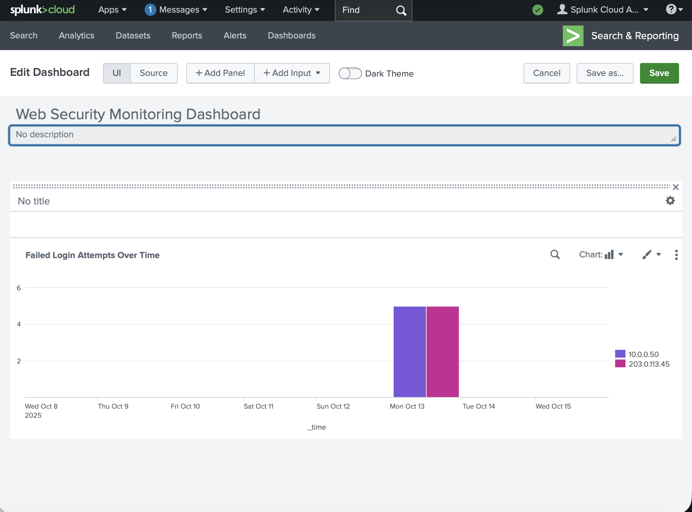
*Same dashboard in edit mode with one column chart, Failed Login Attempts Over Time. Both IPs appear on Mon Oct 13.*

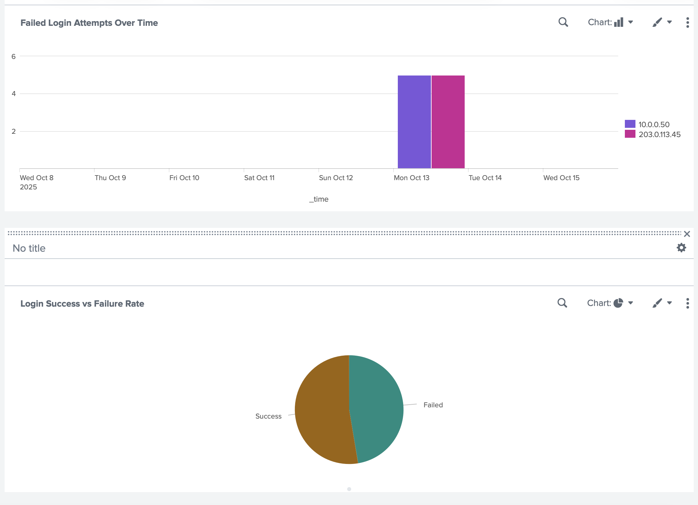
*Column chart of the two IPs on Oct 13, and a pie chart titled Login Success vs Failure Rate. The pie image has no counts printed on it.*

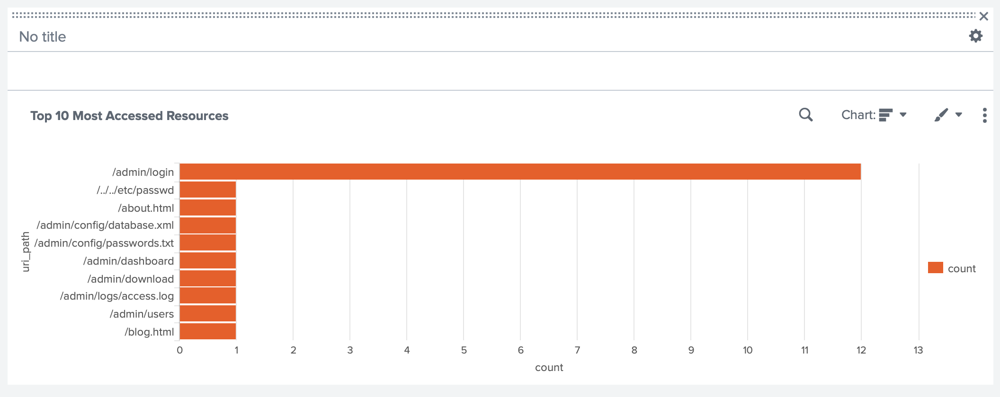
*Bar chart titled Top 10 Most Accessed Resources. /admin/login is the long bar.*

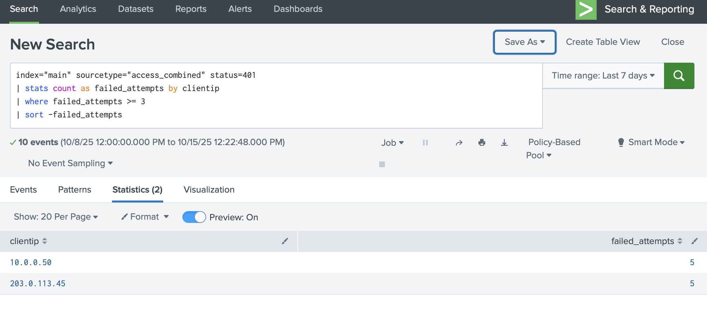
*New Search, not an alert. status=401, count by clientip where count is at least 3. Both IPs are 5. Time range Last 7 days.*

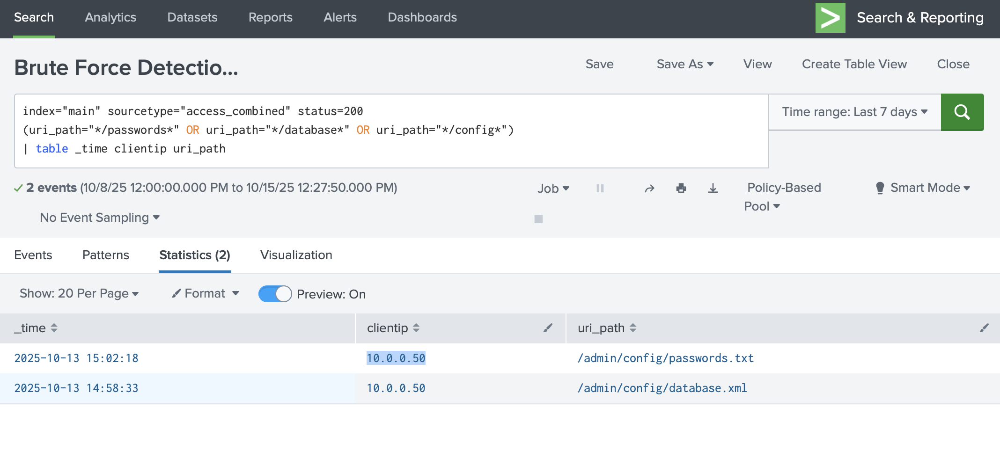
*The window title is truncated to "Brute Force Detectio..." while the query is the sensitive-path search. It returns the same two 200 rows. No alert action is shown.*

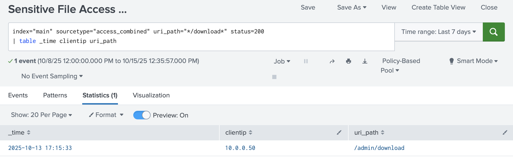
*The window title is truncated to "Sensitive File Access ..." while the query matches download URLs with status 200. One row, /admin/download, with no byte count.*

---

*This lab was completed as part of my cybersecurity training focused on SOC analyst skills and SIEM operations.*
