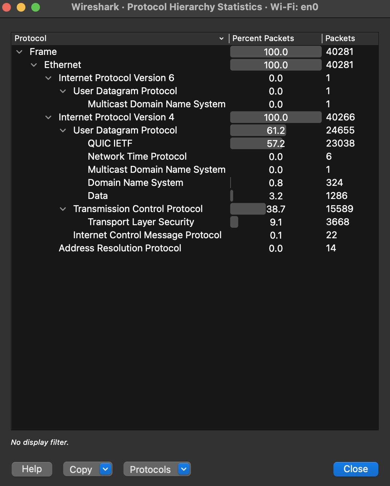
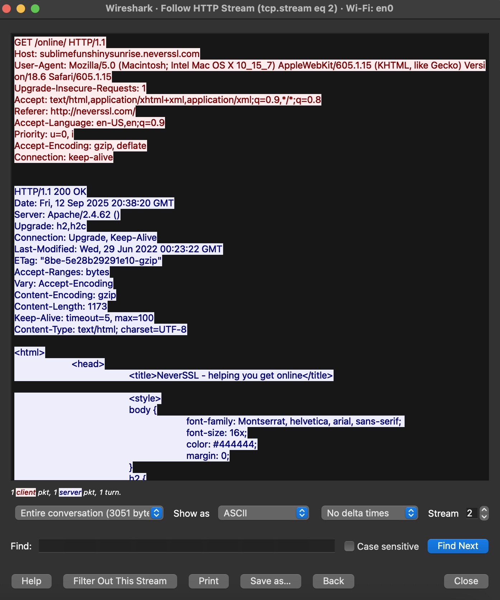
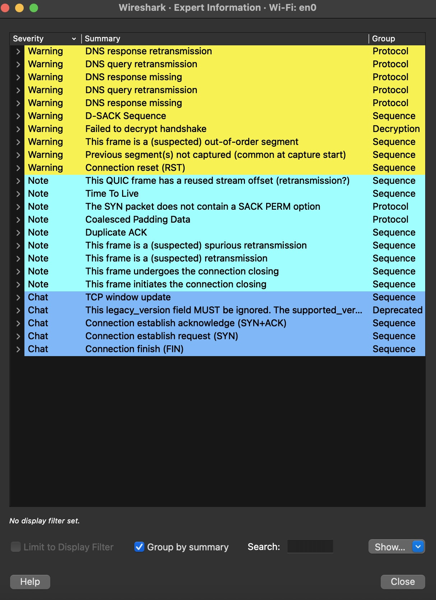

# Network Traffic Analysis with Wireshark

## Lab Overview

Write-up of one live capture on a Mac Wi-Fi interface, plus three screenshots in this folder. No packet-capture file is committed, so the counts cannot be recalculated from git.

Checked against the images on 2026-11-07:

- The percentages and the 40,281 frame total in Key Findings match `protocol-hierarchy.jpg` (Wi-Fi `en0`, no display filter).
- `http-stream.jpg` is a single HTTP stream, not a sample of every web request. The response date inside the capture is Fri, 12 Sep 2025.
- `expert-info.jpg` is the source for the DNS retransmission and connection-reset notes. It also lists a failed decrypt handshake. "No significant security anomalies" is the author's assessment of that list, not a separate test result.
- The sentence about Apple system updates is not a label on these three images.

## Tools Used
- **Wireshark** (build number is not shown in the screenshots)
- **macOS** environment  
- **WiFi** network connection

## Methodology
1. Installed Wireshark and resolved ChmodBPF permissions on macOS
2. Captured live network traffic during normal web browsing (40,000+ packets)
3. Applied protocol filters (DNS, HTTP, QUIC) to isolate specific traffic types
4. Used stream following to analyze complete network conversations
5. Generated statistical reports using Protocol Hierarchy
6. Performed expert analysis to identify network anomalies

## Key Findings

### Modern Internet is Heavily Encrypted
- **57.2%** of packets are labeled QUIC IETF in `protocol-hierarchy.jpg` (23,038 packets)
- **9.1%** used TLS (Transport Layer Security) 
- Minimal unencrypted HTTP traffic found

### Network Communication Patterns
- **UDP dominated** at 61.2% vs TCP at 38.7% (due to modern protocols)
- **DNS queries** preceded all web requests as expected
- **Background services** (Apple system updates) constantly active
- **40,281 total packets** in `protocol-hierarchy.jpg`. That screenshot does not show how long the capture ran

### Network Health Analysis
- Identified DNS retransmissions and connection resets
- Expert Information revealed normal network behavior patterns
- No significant security anomalies detected

## Screenshots

*Statistical breakdown of network protocols showing 40,000+ packets analyzed*

  
*One HTTP stream on Wi-Fi en0 (tcp.stream eq 2). The response date in the capture is 12 Sep 2025.*

*Expert Information for the same interface, grouped by summary. Warning rows include DNS retransmission, connection reset, and failed decrypt handshake.*

## Skills Demonstrated

Topics from this capture. The packet file is not in the repository.

- Live packet capture and analysis
- Network protocol identification
- Traffic pattern recognition
- Stream following and conversation analysis
- Statistical network analysis
- Network forensics fundamentals

## Technical Insights Gained
- Understanding of modern encrypted web protocols (QUIC, TLS)
- Knowledge of network communication flow (DNS → Connection → Data)
- Experience with industry-standard network analysis tools
- Ability to identify and troubleshoot network issues

---
*Lab completed as part of cybersecurity skills development*
